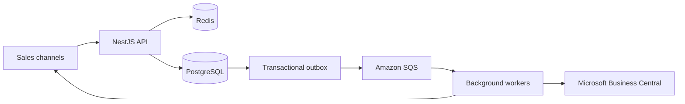

# Order and Inventory Synchronization Design

## Components Involved

1. Own website
2. Nykaa
3. Flipkart
4. Blinkit
5. Microsoft Business Central
6. Order and inventory synchronization service

## 1. Architecture

The system is a modular NestJS monolith with separately deployed API and
background-processing components.

### High-Level Flow


Please have a look at png file

### Main Components

#### NestJS API

- Receives and normalizes orders.
- Deduplicates events.
- Validates SKUs using the sales channel and external SKU ID.
- Reserves stock.
- Passes control to downstream processing.

#### Redis

- Caches product information.
- Performs quick availability checks to reduce database load.

#### PostgreSQL

PostgreSQL is the source of truth for:

- Orders
- Inventory reservations
- Integration state
- Audit history

#### Transactional Outbox and Amazon SQS

The transactional outbox makes order, reservation, and stock-update event
publication atomic with the database transaction.

#### Background Workers

- **Worker Group 1:** Processes stock updates for each sales channel.
- **Worker Group 2:** Manages ERP delivery.
- **Periodic jobs:** Polls Flipkart orders and imports Blinkit CSV files.

#### Operational Dashboard

The dashboard displays:

- Failed reservations and exhausted retries
- Pending ERP deliveries
- Stock synchronization failures
- Retry history
- Inventory audit events

## 2. Data Model

| Table | Purpose and key constraints |
|---|---|
| `Channels` | Stores supported sales channels. The channel name must be unique. |
| `Channel_SKUs` | Maps an external channel SKU to an internal SKU. Unique constraint: (`channel_id`, `external_sku`). |
| `Inventory` | Stores SKU inventory information. `physical_quantity` and `reserved_quantity` cannot be negative; `safety_buffer` defaults to `0`; `version` tracks the latest stock update; `updated_at` records the last update time. |
| `Orders` | Stores `order_id`, `channel_id`, `external_order_id`, status, and timestamp. Unique constraint: (`channel_id`, `external_order_id`). |
| `Order_Items` | Stores `order_id`, SKU, quantity, and purchase price. Quantity must be positive. |
| `Reservations` | Stores order ID, SKU, quantity, reservation status, and timestamp. Unique constraint: (`order_id`, `sku`). |
| `Channel_Events` | Stores event ID, channel, event type, and received time for event coalescing. |
| `Background_Jobs` | Stores job type, status, attempt count, and the next retry time, including jitter. |
| `Stock_Sync_State` | Stores stock quantity, the last-synced version, status, and the last error. Unique constraint: (`channel_id`, `sku`). |
| `Inventory_Logs` | Stores stock-change history, including reason, quantity, triggering unit, and timestamp. |

## 3. Order Ingestion

1. Receive orders from the own website, Nykaa, and Blinkit. Retrieve Flipkart
   orders through scheduled polling.
2. Validate the request and normalize external SKU identifiers to internal
   SKUs.
3. Deduplicate events and orders using database uniqueness constraints.
4. Create or update the order and attempt stock reservation in a PostgreSQL
   transaction.
5. In the same transaction, record stock-synchronization and ERP-delivery work
   in the transactional outbox.
6. Acknowledge the event after the transaction succeeds.

The system avoids:

- Duplicate or out-of-order events repeating a reservation
- Reversal of newer order states by older events, using channel-event versions

If a channel is unavailable, ingestion and polling retry independently.

> **Limitation:** Flipkart marketplace order discovery is available only through
> polling. Because of this external limitation, real-time order discovery is
> not guaranteed.

## 4. Inventory Consistency

```text
available_quantity = physical_quantity - reserved_quantity - safety_buffer
```

In version 1, multi-SKU orders are atomic: either all items are reserved or
none are reserved. PostgreSQL row-level locks protect inventory rows while a
SKU is being processed.

### Concurrent Last-Unit Sales

When two channels sell the last unit simultaneously:

1. Both requests are ingested and deduplicated independently.
2. Each transaction attempts to lock the relevant SKU inventory row.
3. The first transaction to acquire the lock checks availability, increments
   `reserved_quantity`, creates the reservation, records inventory logs, and
   schedules further processing.
4. The first transaction commits.
5. The second transaction then checks the inventory and finds insufficient
   stock.
6. The failed order is displayed on the operations dashboard for manual
   intervention. Customer support can cancel the order and notify the user.

This prevents double reservation of the same inventory.

## 5. Stock Synchronization Workers

Workers update stock on each channel using absolute quantities rather than
relative increments or decrements. This makes updates idempotent and avoids
duplicate-update errors.

| Channel | Synchronization method |
|---|---|
| Own website | Website stock API |
| Nykaa | Single-SKU REST call for the updated SKU; rate limited to 5 requests per second |
| Flipkart | Batch update |
| Blinkit | Urgent stock API |

Additional worker behavior:

- Each channel has its own queue or independently controlled worker group and
  rate limiter.
- Workers prioritize changed SKUs.
- Superseded updates are coalesced.
- Transient failures are retried.
- Each stock update has a monotonically increasing version.
- Workers discard superseded jobs before sending them.

## 6. Failure Handling

- ERP delivery jobs are recorded and retried with jitter.
- Blinkit timeouts retry the latest desired quantity rather than replaying
  obsolete updates.
- Jobs that fail more than the configured threshold are sent to a dead-letter
  queue for investigation with all required diagnostic information.

## 7. Observability

### Initial Metrics and Alerts

- Reservation failures
- Stock synchronization latency, measured from the inventory commit until the
  channel update succeeds
- An alert when the stock synchronization latency exceeds the 60-second target
- Queue status and backlog
- ERP status, including pending orders and the oldest pending delivery

## 8. Scope

### Included in Version 1

- Single-warehouse inventory
- Atomic reservations
- Order and event deduplication
- Asynchronous stock synchronization
- ERP retries
- Audit history
- Basic operations dashboard
- Peak handling by introducing a queue (which internally handles high load)

### Excluded from Version 1

- Multiple warehouses
- Complex order splitting for multi-SKU orders
- Partial fulfillment
- A separate microservice for each integration
- LLM- or AI-based stock distribution across channels
- Removal of manual operations support

## 9. Assumptions

- The warehouse system is the authority for physical stock and provides either 
   stock updates or a way to query the current stock. (External System)
- Each channel provides a stable external order ID. Where available, stable
  event IDs or event versions are also used.
- Business Central supports idempotent order creation or reliable lookup using a
  stable external reference.
- The website can read stock updates from this service or receive them through
  an API.
- The 60-second stock-synchronization target applies under normal conditions. It
  does not apply during external outages or polling delays that the service
  cannot control.
- Returned goods become available again only after the warehouse confirms that
  they are suitable for resale.
- Safety buffers can be configured per SKU or per channel.
- The service would be deployed on AWS. The API and worker processes can scale
  independently, while PostgreSQL and SQS provide durable state and background
  processing.

## 10. Trade-offs

| Decision | Chosen approach | Rejected alternative | Why |
|---|---|---|---|
| Application architecture | Modular NestJS monolith with separate API and worker processes | Multiple independently deployed microservices | This keeps operational overhead lower and allows faster delivery. |
| Inventory authority | PostgreSQL transactions and row-level locks | Redis-only reservations | Durable transactions and database constraints protect the last unit when requests arrive at the same time. |
| Background processing | Transactional outbox and SQS | In-memory jobs or direct synchronous API calls | This prevents downstream work from being lost and keeps slow integrations from blocking order processing. |
| Stock synchronization | Per-channel rate limits and latest-quantity coalescing | Synchronous updates to every channel for each order | This respects channel API limits and prevents one failing channel from blocking the others. |
| ERP delivery | Durable retries with stable external references and reconciliation | Unconditional retry after every timeout | This handles ambiguous outcomes and reduces the chance of creating duplicate ERP orders. |

## 11. AI Usage Note

1. Used OpenAI ChatGPT for deliverables and understanding
2. Used Mermaid for Architecture drawing
3. Copilot for formatting my Google doc into .md file

Link to Google-doc: https://docs.google.com/document/d/18V1631F_-DBLddn-vo3CkVCa-W0i4ZzaLibzNT1zJjY/edit?usp=sharing
